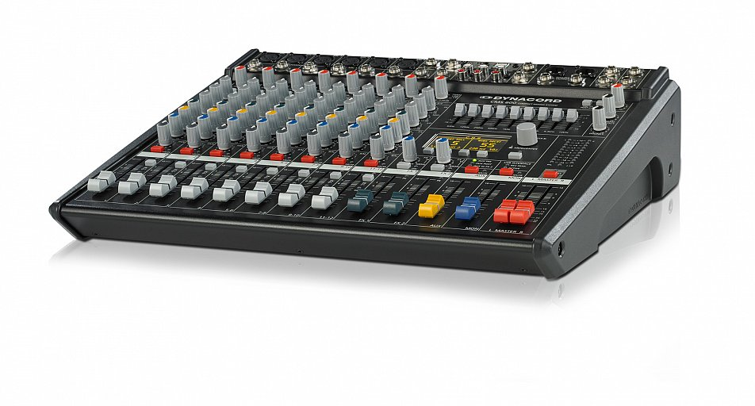

# Dynacord CMS 600-3 USB Capture

This repository contains a capture of USB communication between a Windows host and a Dynacord CMS 600-3 mixer.

> **Looking for a driver?** There is now a macOS driver for the old (Ploytec-based) CMS 600-3 that runs on Apple silicon Macs without disabling any security features. Download it from the [dominics/Ozzy releases page](https://github.com/dominics/Ozzy/releases), or install it with Homebrew: `brew install --cask dominics/tap/ozzy-cms600`

This 8-channel mixer is available in two hardware variants: the new one is USB class-compliant, but the old one uses a [Ploytec](https://www.ploytec.com/) USB audio interface card, and drivers for it are no longer available on modern versions of MacOS nor Apple-chipset Mac hardware like the M1-M4. (See [the note here](https://products.dynacord.com/binary/Technical_Note_USB%20drivers_Powermate-CMS_EN.pdf): "drivers not listed are not available")

The [Ploytec REVIVAL](https://www.ploytec.com/revival/) firmware does not yet support this hardware. Instead, the fork [dominics/Ozzy](https://github.com/dominics/Ozzy) of the open-source [mischa85/Ozzy](https://github.com/mischa85/Ozzy) driver (formerly snd-xonedb4) adds CMS 600-3 support, reverse-engineered from these captures: 4 inputs and 4 outputs at 44.1, 48 and 96 kHz, plus USB-MIDI. Releases are on [its releases page](https://github.com/dominics/Ozzy/releases).

The capture is provided as a .pcap file, captured using USBPCap, on Windows (where there is still a working driver).

The Dynacord CMS 600-3 uses the USB Vendor ID of `0x0562` and Product ID of `0x03eb`

## Owner's manual

[docs/cms600-3-owners-manual.pdf](docs/cms600-3-owners-manual.pdf) is Dynacord's English/German owner's manual for the CMS 600-3 (80 pages, 2017), kept here in case it disappears from Dynacord's site. It was downloaded on 2026-10-09 from https://products.dynacord.com/download/979323 (sha256 `c01dd1ce696e1359b857cf9f771a9d9cbb3f73a660982597d8d8254857654ac3`). Section 4 covers the USB "DIGITAL AUDIO INTERFACE" and its routing.
